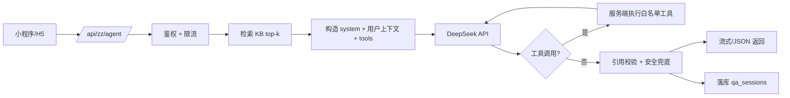

# AI 智能体接入评估（DeepSeek 官方 API）

> 状态：**未接入**。当前 `/api/zz/ask` 仍是关键词 + 2-gram 检索拼接，不是 LLM，也不是 agent。本文评估接入难度、边界与分阶段路线。

## 1. 结论

接入本身不难，难的是把它做成“可控的照护智能体”。

| 目标 | 难度 | 预估 | 主要工作 |
|---|---|---|---|
| 单轮问答 + 知识库引用 | 低 | 1–3 天 | 服务端代理、prompt、KB 检索注入、错误兜底 |
| 多轮对话 + 流式 + 安全话术 | 中 | 3–7 天 | 会话表、SSE/小程序分块、限流、红线规则、引用校验 |
| 只读工具 agent（查 HPS/打卡/干预） | 中高 | 1–2 周 | tool schema、服务端执行、权限、审计、最大步数 |
| 可写工具 agent（记录干预/打卡/提醒） | 高 | 2–4 周 | 二次确认、幂等、回滚、操作日志、防误写 |
| 可研究/可上线的照护 agent | 高 | 1–2 个月+ | 评测集、双人标注、隐私/伦理、成本与可用性 |

## 2. DeepSeek API 事实（2026-10）

- OpenAI 兼容：`base_url=https://api.deepseek.com`，Bearer key；也提供 Anthropic 兼容端点。
- 当前模型：`deepseek-flash`、`deepseek-v4-pro`（官方文档列出的名称；不要写死已退役的旧名）。
- 支持流式；支持 Tool Calls；thinking mode 也支持工具调用；`strict` 工具模式为 beta，需 `https://api.deepseek.com/beta`，schema 要求 `additionalProperties: false`、所有字段 required。
- 参考：[快速开始](https://api-docs.deepseek.com/)、[Tool Calls](https://api-docs.deepseek.com/guides/tool_calls)。

## 3. 架构

## 4. 工具边界

不要让模型直接写数据库。工具全部在服务端执行、白名单、带用户上下文：

| 工具 | 类型 | 约束 |
|---|---|---|
| `search_kb(query)` | 读 | 只返回知识库原文与 ID；无命中明确说没有 |
| `get_latest_hps()` | 读 | 只返回 HPS、分层、覆盖度；不返回 note |
| `get_recent_checkins(days)` | 读 | 结构化摘要，限制天数/条数 |
| `recommend_interventions(level)` | 读 | 只读方案库，不生成新方案 |
| `log_intervention(...)` | 写 | 必须用户二次确认；服务端校验参数与幂等 |
| `escalate_crisis()` | 写/副作用 | 由确定性规则触发，不交给模型判断 |

建议：默认最大工具步数 3–5；每次工具调用写审计；写操作必须 `confirmed=true`。

## 5. 安全与合规

- **临床边界**：不诊断、不处方、不替代急救；PHQ-9 第 9 题红线由服务端规则触发，agent 只转交固定安全卡片。
- **隐私**：情绪、睡眠、照护负担属敏感个人信息。发送给 DeepSeek 属于委托处理；需单独同意、隐私政策披露、最小化发送（默认不发 `note`、社区内容、TTS 文本），并核对 API 条款中的数据保留/训练政策。
- **提示注入**：用户输入与检索内容都要视为不可信；system prompt 明确资料边界；工具参数由服务端白名单校验。
- **幻觉**：要求“只基于给定资料回答，并标来源”；引用校验失败则降级为原检索答案。
- **成本**：按 token 计费；加用户/日配额、超时、重试、熔断；默认关闭 thinking，复杂任务再开。

## 6. 跨端流式

- H5：SSE 可直接用。
- 微信小程序：不支持 `EventSource`；用 `wx.request` 的 chunked 能力或先做非流式 + 加载态。Taro 端建议先非流式，稳定后再做分块。
- 超时/取消：用户离开页面要 abort；上游超时降级到本地 KB。

## 7. 分阶段

1. **Phase 1（1 周）**：RAG 问答，非流式，带引用和“没找到”兜底，保留现有检索作为 fallback。
2. **Phase 2（1–2 周）**：流式 + 多轮 + 只读工具，限流与审计。
3. **Phase 3（2–4 周）**：写工具，二次确认、幂等、可回滚；先只做“记录干预”一个写操作。
4. **Phase 4**：评测集、隐私/伦理、成本与可用性，再决定是否对外。

## 8. 评测

如果论文/汇报要称“智能体”，至少需要：

- 50–100 条金标准问题，覆盖知识问答、工具调用、拒答、红线；
- 指标：答案正确性、引用是否支持、拒答正确率、红线处理、延迟、单次成本；
- 与现有检索式问答做对照；
- 记录 `model`、`prompt_version`、`tokens`、`tool_calls`、`safety_flag`，可复现。

## 9. 仓库落点

- `pb_hooks/lib/kb.js`：保留检索；新增 `llm.js` 做 DeepSeek 代理与 prompt。
- `/api/zz/ask`：保持现有契约；LLM 作为可选后端，未配置 key 时降级。
- `qa_sessions`：扩展 `model`、`prompt_version`、`tokens`、`latency`、`tool_calls`、`safety_flag`、`conversation_id`。
- `.env`：`DEEPSEEK_API_KEY`；服务端读取，客户端不接触。
- 前端：问答页增加“AI 生成/资料来源”标识与停止生成；TTS 默认不读 AI 回答。

## 10. 非目标

- 不做通用聊天助手；只做照护场景内的受控问答与工具调用。
- 不让模型直接执行数据库写操作。
- 不在没有评测与安全兜底的情况下对外宣称“AI 诊断/治疗”。
