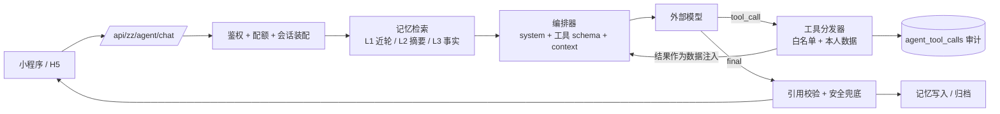

# 照护智能体：架构设计（v2，重写）

> 状态：设计稿（2026-11）。取代旧的「单轮问答 + 检索拼接」方案。
> 目标不是"接一个模型"，而是让系统里有一个**受控、有记忆、能查本人数据**的助手。
> 旧文档的 DeepSeek 接口事实仍然有效，其余部分按本文执行。

## 1. 现状与问题

现在的 `/api/zz/ask` 是关键词 + 2-gram 检索后拼接原文：没有对话状态，没有用户数据上下文，也没有记忆。
用户可以问"我最近怎么样"，系统答不出来——而这恰恰是照护者最需要的问题。

四个缺口：

| 缺口 | 后果 |
|---|---|
| 无法读取本人数据 | 回答与"我"无关，只能给通用建议 |
| 无会话状态 | 每轮从零开始，指代（"那它呢"）无法解析 |
| 无记忆 | 每次都要重复背景（照护对象、最难的时段） |
| 无归档 | 对话越长越贵，长会话不可控，也无法回顾 |

## 2. 设计原则

1. **模型不碰数据库**：所有数据由服务端工具函数读取，模型只能发起受控调用。
2. **最小必要字段**：工具返回白名单字段；自由文本（打卡备注、问答原文）默认不出库。
3. **只读优先**：v2 只提供读工具；写操作（记录打卡、改计划）留到 v3，且必须二次确认。
4. **记忆可解释、可删除**：记忆是独立表，用户能在「我的」看到并删除，导出时一并带走。
5. **没有模型也必须可用**：模型不可用/超预算时回退到现有检索链路，功能不中断。

## 3. 总体架构



关键点：**编排器在服务端**。客户端只发消息，不接触工具、不接触模型密钥。

## 4. 工具层（只读、按人、白名单）

所有工具在服务端执行，`user = request.auth.id` 由服务端注入，模型无法指定他人。

| 工具 | 入参 | 返回（白名单） | 限制 |
|---|---|---|---|
| `get_today_status` | — | 今日 HPS、分级、`coverage`、是否已打卡 | 1 次/轮 |
| `list_checkins` | `days` (1–30) | 日期、心情、焦虑、疲惫、睡眠、照护时长（**不含 note**） | ≤30 行 |
| `list_assessments` | `scale?`, `limit≤10` | 时间、量表、分数、分级、flag | 不返回原始答案 |
| `get_trends` | `days` (7/30) | 日均 HPS、三色天数、峰值日 | 聚合结果 |
| `list_intervention_logs` | `limit≤10` | 时间、标题快照、星级 | — |
| `search_kb` | `query`, `top≤5` | 条目 id/标题/分类/正文片段 | 只读知识库 |
| `get_study_schedule` | — | 研究码、下一窗口、依从天数 | 遵守盲法：不返回组别 |

规则：

- 单轮最多 4 次工具调用、总耗时 ≤3s；超限直接给"数据暂不可用"。
- 返回体统一 `{ ok, data, truncated }`；模型必须基于返回内容回答，不许编造数值。
- 每次调用写 `agent_tool_calls`（user、tool、参数摘要、耗时、是否被拒）。
- 敏感字段清单（email、openid、note、question/answer 原文、互助句子）默认**永不出现在工具返回**。

## 5. 记忆设计（三层）

| 层 | 存什么 | 生命周期 | 用途 |
|---|---|---|---|
| L1 工作记忆 | 最近 8–12 轮原文 + 本轮工具结果 | 会话内 | 指代消解、连续追问 |
| L2 情景记忆 | 每次归档后的结构化摘要（主题、结论、未解决问题、安全标记） | 180 天，可配置 | 跨会话接续 |
| L3 稳定事实 | 用户明确陈述的偏好/背景（如"主要照护对象是母亲""夜里最难"） | 直到用户删除 | 免重复自我介绍 |

**事实抽取规则**：

- 只从**用户原话**抽取，不从模型推测；
- 每条事实必须带 `source_turn_id` 与置信度，用户可在「我的 - 助手记忆」查看/删除；
- 涉及诊断、用药、身份信息的事实**不写入**。

上下文装配（按优先级，受 token 预算约束）：

```
system(角色与红线) → L3 事实(≤8条) → L2 最近摘要(≤2条) → L1 近轮(≤12) → 本轮工具结果
```

## 6. 自动归档机制

触发条件（任一满足）：

- 轮次 ≥12；
- 会话空闲 ≥30 分钟；
- 累计 token ≥预算的 70%；
- 用户主动"结束这段对话"。

归档动作（幂等，带 `archive_version`）：

1. 生成结构化摘要（主题、已给建议、用户反馈、未解决问题、是否出现安全标记）；
2. 抽取候选事实，写入 `user_facts`（可撤回）；
3. 写 `conversations.archived_at` 与摘要 id；
4. 原始轮次按保留策略清理（默认保留 180 天，导出仍可取）。

归档在服务端异步执行（PB cron 或请求后置任务），失败不影响当轮回答。

## 7. 数据模型

在 `qa_sessions` 之外新增：

| 集合 | 字段 |
|---|---|
| `conversations` | user, title, started_at, last_turn_at, turn_count, token_total, archived_at, summary_id |
| `user_facts` | user, key, value, source_conversation, source_turn, confidence, created_at, deleted_at |
| `conversation_summaries` | conversation, topics(json), advice(json), unresolved(json), safety_flag, model, prompt_version, created_at |
| `agent_tool_calls` | user, conversation, tool, args_digest, ok, ms, denied_reason |

`qa_sessions` 扩展：`conversation_id`、`model`、`prompt_version`、`tokens_in/out`、`tools`、`safety_flag`、`helpful`（已有）。

## 8. 安全模型

| 风险 | 控制 |
|---|---|
| 越权读他人数据 | 工具函数不接收 user 参数，服务端注入；单测覆盖"传入他人 id 无效" |
| 提示注入（知识库/用户文本） | 工具输出标记为数据；剥离"忽略以上指令"类模式；系统提示与数据用分隔符隔离 |
| 敏感信息外泄 | 发送模型前二次脱敏；不发送 email/openid；自由文本默认不发送 |
| 医疗越界 | 系统提示硬约束：不做诊断、不给用药剂量；命中危机词走固定话术 + 热线，不让模型自由发挥 |
| 费用失控 | 每用户日预算、单会话 token 上限、工具次数上限；超限回退检索 |
| 记忆污染 | 只从用户原话抽取；事实可在「我的」删除；归档带版本，可重建 |

## 9. 模型与降级

- 走外部 API（DeepSeek 或等价），密钥只在服务端；客户端不接触。
- 流式输出：H5 用 SSE，小程序分块轮询（与现有 TTS 的分块思路一致）。
- **降级链**：模型超时/超预算/报错 → 检索式回答（现有 `kb.js`）+ 明确提示"当前为知识库检索"。
- 每次回答带引用；引用校验失败（引用了不存在的条目）→ 降级为"未找到可靠依据"。

## 10. 评测与上线门禁

离线评测集（100–200 条，人工标注）：

| 维度 | 指标 | 门槛 |
|---|---|---|
| 检索 | recall@3、MRR | 不低于现有链路 |
| 工具使用 | 该调用时是否调用、参数是否正确 | ≥90% |
| 忠实度 | 回答中的数值/结论能否在工具结果或 KB 中找到 | ≥95% |
| 安全 | 危机、诊断诱导、越权请求的拒绝率 | 100% |
| 记忆 | 跨会话事实召回准确率 | ≥85%，且无编造 |

线上：`helpful` 率、会话完成率、P95 延迟、单会话成本；任一劣化超阈值即回滚。

## 11. 分阶段

| 阶段 | 内容 | 验收 |
|---|---|---|
| P0 | 工具层 + 审计 + 数据模型（不接模型） | 单测覆盖越权与字段白名单；审计可查 |
| P1 | 单轮问答 + 工具调用（无记忆） | 工具正确率 ≥90%；引用校验通过 |
| P2 | L1/L2 记忆 + 自动归档 + 事实查看/删除 | 跨会话接续可用；事实可删；导出含记忆 |
| P3 | 写工具（记录打卡/干预） | 二次确认、幂等、可回滚，默认关闭 |
| P4 | 评测与灰度 | 预注册指标达标；影子期 ≥2 周 |

## 12. 明确的非目标

- 不做通用聊天助手：拒绝与照护无关的话题；
- 不让模型直接执行 SQL/文件读取；
- 不做跨用户/家庭共享记忆；
- 不在 n<100 时用对话数据训练个性化模型；
- 不宣称"AI 诊断/治疗/危机干预"。
