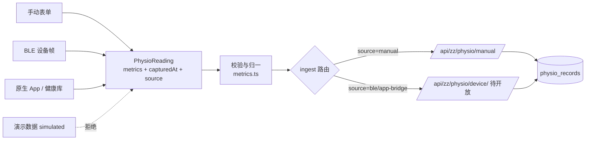

# 生理数据接入（APP 端 / 蓝牙 / 手动）

> 状态：契约与小程序侧实现已落地；设备与原生桥是**空位**，不在真机验证范围。服务端设备入口 `/api/zz/physio/device` 尚未开放，当前只有手动录入可写库。
> 代码：`miniapp/src/lib/physio/`；服务端：`pb_hooks/lib/hps.js`、`pb_hooks/account.pb.js`（手动入口）。

## 1. 为什么要一层接入抽象

生理数据会从至少三类通道进来：

| 通道 | 采集方 | 现状 |
|---|---|---|
| 手动 | 小程序表单 | 可用（`/api/zz/physio/manual`） |
| 蓝牙设备 | 小程序 BLE | 契约就绪，无登记设备，`DEVICE_PROFILES` 为空 |
| 原生 App / 系统健康 | Flutter / Kotlin（HealthKit、Health Connect） | 未接；契约在 `sources/app-bridge.ts` |

三者如果各自直连 API，会出现三个问题：字段与单位漂移、来源被伪造、研究导出混入模拟数据。因此在采集与入库之间加一层 `PhysioReading` 契约，**来源只决定信誉与路由，不参与 HPS 计算**。

## 2. 分层



- `types.ts`：`PhysioReading`、`PhysioSource`、`DeviceProfile`。
- `metrics.ts`：指标范围、单位、取整规则；换单位/换算法只改这一处。
- `ingest.ts`：`ingestPhysio()` 唯一入库入口；按 `source` 选服务端路由，`simulated` 直接拒绝。
- `sources/ble.ts`：`json-v1` 帧解析 + `BlePhysioSource`（连接、notify、超时）。
- `sources/app-bridge.ts`：原生壳注入读数的桥；未注入时 `isAvailable()=false`。
- `mood.ts`：心情 1–5 字典，首页记录列表与打卡页共用。

## 3. 契约

### 3.1 小程序内部

```ts
interface PhysioReading {
  metrics: Partial<Record<'hrv' | 'gsr' | 'sleep_quality' | 'steps', number>>
  capturedAt: Date
  source: 'manual' | 'ble' | 'app-bridge' | 'simulated'
  deviceId?: string
}
```

缺失指标就是「没测到」，**不要补 0**；HPS 按覆盖率处理缺失。

### 3.2 原生 App 直传服务端

原生端不依赖小程序代码，按以下字段 POST：

```http
POST /api/zz/physio/device
Authorization: Bearer <device_token>
Content-Type: application/json

{
  "source": "app-bridge",
  "device_id": "<stable-device-id>",
  "captured_at": "2026-11-04T08:30:00+08:00",
  "metrics": { "hrv": 32.4, "gsr": 5.1, "sleep_quality": 68, "steps": 2810 }
}
```

服务端要求（与 [backend-roadmap.md](backend-roadmap.md) P0 一致）：

1. 以 token 识别设备与用户，**不信客户端 `source`/`date`**，写入 `received_at`、`device_id`。
2. 校验指标范围（与 `metrics.ts` 同表）；缺失指标落空，不落 0。
3. 按 `(device_id, captured_at)` 去重，允许同一天多条 append-only 记录。
4. `simulated` 只能进演示库；研究导出排除。

### 3.3 小屏原生壳桥

原生壳启动时注入：

```ts
registerAppBridge(async () => ({
  metrics: { hrv, gsr, sleep_quality, steps },
  capturedAt: new Date(),
  source: 'app-bridge',
  deviceId,
}))
```

`pickPhysioSource()` 按「原生桥 → 已登记蓝牙」顺序探测；都不可用返回 `null`，界面引导手动录入，**不展示伪造读数**。

## 4. 接入新硬件 / 新平台的步骤

1. **登记设备**：在 `sources/ble.ts` 的 `DEVICE_PROFILES` 填入广播名前缀、服务/特征 UUID、帧格式与超时。
2. **解析帧**：`json-v1` 直接用；二进制帧加一个 `parseXxxFrame(): PhysioReading`，并在 `BlePhysioSource` 里替换调用。
3. **入库路由**：设备数据必须走 `/api/zz/physio/device`；服务端路由未就绪时 `ingestPhysio` 会显式报错，不会降级写手动。
4. **原生端**：按 3.2 实现直传；小程序侧只需 `registerAppBridge` 用于展示。

## 5. 红线

- `simulated` 与演示账号数据不得进入研究数据集。
- 不得把蓝牙/原生数据写进 `/api/zz/physio/manual`（会污染 `source`）。
- 缺指标不得补 0；无数据不得返回绿色分层（见 [hps-method.md](hps-method.md)）。
- 研究导出默认排除 `note` 与设备原始标识，只保留去标识后的数值与时间。

## 6. 迁移记录（2026-11）

- 旧 `lib/ble.ts` 拆为 `lib/physio/` 模块；BLE 帧解析不再把缺失指标写成 0。
- 手动录入改走 `ingestPhysio()`，页面只做交互，不再直接拼 API 参数。
- 首页与打卡页共用 `mood.ts`，删除两份重复字典。
