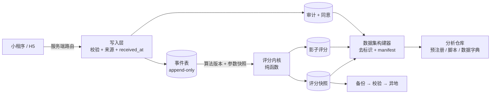

# 平台化：基础设施与科研工具

> 状态：分析（2026-11）。本文只处理三件事——**可复现**、**可审计**、**可导出**。
> 功能级 P0 清单仍在 [backend-roadmap.md](backend-roadmap.md)，测量学路线仍在 [hps-method.md](hps-method.md)；
> 本文不重述它们，只回答「为什么现在做不出可信结论」以及「要建哪些工件才能」。
> 文中「现状」一律以代码为准并标注位置；文档与代码不符的条目单列在 §7。

## 0. 结论

1. **它是一个应用，不是一个平台。** 链路能跑，但交付、数据、研究三条链路都不具备可复现性：同一份数据算两次 HPS 可能不同，任何一次历史评分都无法复算，任何一份导出的数据集都无法说明它包含什么。
2. **最贵的缺口不是功能，是参数不入库。** `stress_scores` 只存结果（`pb_migrations/1730000000_init_schema.js:80-95`），`app_config` 改完即覆盖，评分 upsert 覆盖同日旧值（`pb_hooks/lib/hps.js:200-213`）。这意味着论文里写不出「用的是哪版权重」，审稿人一复现就崩。
3. **基础设施的瓶颈不是扩容，是边界。** 注册默认开放、客户端可伪造来源与日期、付费 TTS 无配额、备份无恢复演练、宿主机状态靠 `sed` 与手改。这些都是「对外可用」的前置条件，不是性能问题。
4. **科研工具当前为零。** 仓库没有任何导出、去标识、数据集版本、评测集、分析脚手架；只有一份 seed 迁移把合成数据写进生产库（`pb_migrations/1730000100_seed_demo.js:34-46,249`）。

## 1. 现状核查（代码事实）

| 维度 | 现状 | 证据 | 判定 |
|---|---|---|---|
| 注册边界 | 代码层公开可注册；只在文档里写「未对外开放」 | `users.createRule` 为空串（任意人可 POST 建号）；`miniapp/src/pages/login/index.tsx:35` 调 `register()` | 阻塞上线 |
| 写入可信 | 打卡/生理由客户端直写，`source`、`date`、`user` 全部客户端给 | `miniapp/src/lib/api.ts:376-394,410-426`；`pb_migrations/1730000000_init_schema.js:41-44,69-72` | 阻塞研究 |
| 评分可回放 | 结果单行 upsert，无 `algorithm_version`/`params`/`coverage`/`computed_at` | `pb_hooks/lib/hps.js:200-213` | 阻塞研究 |
| 缺失语义 | 缺生理写 0；context 恒入模（无打卡时=0） | `pb_hooks/lib/hps.js:173,208` | 假阴性风险 |
| 生理时效 | 今日无记录时回退到**任意久远**的一条，无窗口上限 | `pb_hooks/lib/hps.js:104-117` | 跨期污染 |
| 安全标记流转 | PHQ-9 第 9 题命中置 `flag=true`，但分级仍可 green、建议仍写「在一般范围内」；无处置流程 | `pb_hooks/lib/scales.js:31,84,93` | 安全缺口 |
| 参数治理 | `app_config` 仅 superuser 可写、无校验、无历史 | `pb_migrations/1730000000_init_schema.js:280-291` | 阻塞研究 |
| 量表锚定 | 计分在服务端（正确），但与 HPS 无显式关联字段、无索引 | `pb_hooks/lib/scales.js`；`pb_migrations/1730000300_assessments.js` | 阻塞研究 |
| 数据权利 | 无导出、无注销；删除只有集合级 `remove` | 无 `/api/zz/account/*` 路由 | 合规阻塞 |
| 配额/成本 | `/api/zz/ask`、`/api/zz/tts` 无用户级限流与计量；TTS 计费 | `pb_hooks/tts.pb.js:29-45`；`pb_hooks/zhihu.pb.js:75-110` | 成本/滥用风险 |
| 敏感文本落盘 | TTS 把任意调用方文本按 sha256 落盘到数据卷，随每日备份一起外带 | `pb_hooks/tts.pb.js:66-95`；`docker/backup.sh` | 数据最小化缺口 |
| 定时任务 | 仓库内无 `cronAdd`；「多副本会重复执行」的前提不存在 | `grep cronAdd pb_hooks` 为空 | 文档漂移 |
| 测试 | CI 只有前端 `tsc`；后端 JS/hook/迁移零测试 | `.github/workflows/build-and-deploy.yml:35-63` | 交付风险 |
| 索引 | 除 `users.wechat_openid` 外无自建索引；`stress_scores(user,date)` 无唯一约束 | 本地库 `sqlite_master` 仅 `idx_users_wechat_openid` | upsert 竞态 |
| 备份 | 每日 04:30 + 部署前备份 + 导出到宿主；**未做过恢复演练** | `docker/backup.sh`；`docs/deploy.md:100-118` | 未验证 |
| 部署 | 服务器上 `sed -i` 改写 compose 的 image 行 → 宿主机状态与仓库分叉 | `docker/deploy.sh:95,132` | 漂移源 |
| 反向代理 | 仓库里没有代理配置；提交信息称 Caddyfile 是 source of truth | `92889d6`；`docs/deploy.md:12-20` 写的是 nginx | 不可复现 |

### 1.1 运行时实证（临时库，PocketBase 0.40.5，仓库迁移 + hooks）

用 `/tmp` 空目录起真实例跑了一遍边界探测，以下为实测结果，不是推断：

| 探测 | 结果 | 含义 |
|---|---|---|
| 匿名 `POST /api/collections/users/records` | **200**，直接建号成功 | 注册确实对外，非仅文档问题 |
| 匿名 `GET checkins / stress_scores / app_config` | 200 但 `totalItems=0` | 规则作为过滤器生效，无跨用户泄露 |
| 匿名 `POST /api/zz/ask`、`/zz/tts` | 401 | 自定义路由鉴权正确 |
| 登录后伪造 `physio_records`：`source=device`、`date=2020-01-01` | **200** | 来源与日期可任意伪造 |
| 登录后伪造 `checkins`：`date=2030-12-31` | **200** | 未来日期可写入，无校验 |
| 登录后直写 `stress_scores` / `assessments` | 403 | 结果表收口正确 |
| PHQ-9 第 9 题=1、总分 1 | `level=green`、`advice=「在一般范围内」`、`flag=true` | 安全话术与安全标记脱节 |

**最关键的一条**：同一天、同一份打卡，只因库中存在一条 2020 年的伪造生理记录，HPS = **72 / red / score_physio=100**；删除该记录后重算，HPS = **53.3 / yellow / score_physio=0**。

一次删除让同一天的分层跨了两档。这说明当前分数不是「数据的函数」，而是「库里恰好有什么的函数」——在补齐 B1（事件 + 版本 + 回放）之前，任何跨用户、跨时间的分析都不可解释。

## 2. 分级：现在在哪一级

| 级别 | 判据 | 当前 | 缺口 |
|---|---|---|---|
| L0 单机可跑 | 有人能点通全链路 | ✅ | — |
| L1 可复现交付 | 任意 commit 能起同构环境；后端改动有自动化验证；配置即代码 | ❌ | 后端零测试、宿主状态靠手改、代理配置不在仓库 |
| L2 可信数据 | 写入不可伪造；评分可回放；参数有版本；导出可去标识 | ❌ | §1 的「写入可信 / 评分可回放 / 参数治理 / 数据权利」四行 |
| L3 可审计研究平台 | 同意/审计/数据集 manifest/评测集/分析可复现 | ❌ | 科研工具为 0 |

**当前卡在 L0→L1 与 L1→L2 之间：不补齐 L1，L2 的改动无法被验证；跳过 L2 直接做 pilot，产出的数据不可用于结论。**

## 3. 目标形态

三条硬约束：**写入只经服务端**、**评分只读事件**、**导出只读 manifest 覆盖的数据**。

## 3.1 科研与生产一体化、在线化

现状：**生产和研究是两个动作**。生产侧写库、研究侧靠人工离线导出；没有事件流、没有在线指标、
影子模型无处安放。于是「研究结论」永远滞后于「系统状态」，而系统改一次参数，历史结论就失去参照。

一体化的定义（不是"把分析搬进后台"，而是**同一条数据流水线**）：

| 环节 | 现状 | 目标 | 判据 |
|---|---|---|---|
| 采集 | 打卡/生理/量表各自入表 | 统一事件表（append-only，含来源、`received_at`、版本） | 任一用户任一时刻的业务动作都有事件 |
| 计算 | 写入 hook 里同步算分 | 事件 → 评分内核（纯函数 + 版本）→ 快照 / 影子 | 快照可由事件重算到同值 |
| 质控 | 无 | 在线指标：分量覆盖率、EMA 依从、设备占比、异常值 | 指标跌破阈值即告警，而不是导出后才发现 |
| 研究 | 离线导出 | 研究视图 + 数据集构建器（manifest + 去标识 + 同意门控） | 论文表格可由 manifest 重建 |
| 发布 | 改权重即生效 | 影子并行 → 预注册指标 → 灰度 → 记录版本 | 任何权重/模型变更都有影子期与决策记录 |

线上化的三个具体转法：

1. **评分在线化**：分数不再是"当次算出来的数"，而是"某个事件序列 + 某个算法版本"的确定性输出。
   线上展示用快照，研究用重放，两者同源。
2. **评测在线化**：检索问答（现在的 `kb.js`）与未来的 LLM 共用一套固定评测集，
   每次改词库/改提示/换模型都跑同一评测并落版本，避免"感觉变好了"。
3. **数据资产在线化**：`dataset manifest` 成为发布物之一（与镜像 tag 同级）。
   一次导出 = 一个可引用的版本；撤回同意的用户从下一版消失。

结构化互助带来的额外研究面：`whispers` 的**词元分布与回应密度**可按 cohort 聚合，
不含自由文本，天然低隐私风险，可以作为"情境压力"的外部相关变量。

代价与红线：

- 写入路径变长（事件 + 异步重算），必须幂等、可重放、可补算；单写容器仍是前提。
- 在线化 ≠ 实时出结论：pilot 阶段不做日内动态调权，也不做在线学习。
- 生产环境**不允许**直接调整展示用权重；一切变更先影子，后决策，再记录。
- 研究视图与研究导出必须带 `consent` 门控；平台内部看板不受此限，但对外材料只认 manifest。

验收：

- 任一历史分数可回溯到「事件 + 算法版本 + 参数」；
- 任一论文表格可由 manifest 重建，且重建过程无手工步骤；
- 权重/模型变更先影子 ≥7 天并留下指标对比，再决定是否上线；
- 用户撤回研究同意后 24 小时内不出现在新版本数据集中。

## 4. 基础设施清单（A）

| # | 工作 | 现状 → 动作 | 验收 |
|---|---|---|---|
| A1 | 环境分层与合成数据隔离 | ✅ 2026-11：seed 迁移改为仅 `SEED_DEMO=1` 执行；`1730000600` 清理既有 demo 账号与 `simulated` 记录 | 新建库跑完迁移后 `users`/`physio_records` 为空（已实测） |
| A2 | 后端进 CI | 只有 `tsc` → 加：临时库 `migrate up/down` 往返、hook 纯函数单测（node 直接跑 `lib/*.js`）、真实 PB 二进制起容器后跑冒烟（登录→打卡→评分→量表→导出） | PR 上三项必绿；迁移不可逆或数据丢失的改动会被拦下 |
| A3 | 写入收口与来源可信 | 客户端直写集合 → `POST /api/zz/checkins`、`/physio/manual`、`/physio/device`（token）；集合写规则收为 `null`，服务端写 `received_at`/`source`/`device_id` | 客户端伪造 `source`/`date` 的请求返回 4xx；库里不存在服务端未写过的来源值 |
| A4 | 参数与配置治理 | ✅ 校验 2026-11：非法权重/倒序阈值被 400 拒绝；`app_config_history` 记录每次写入；评分快照内嵌 `params` | 非法权重被拒（实测）；历史分数可复算（快照字段已落库） |
| A5 | 配额与成本 | ✅ 2026-11：`usage_counters(user,date,kind)` + `daily_quota` 配置；问答与 TTS 超限返回 429（TTS 命中缓存不计数）。仍缺：TTS 缓存出数据卷、IP 级限流 | 连续提问超限即 429（实测） |
| A6 | 可观测性与告警 | 只有容器 json-file 日志 → 结构化日志 + `request_id`；5xx/延迟/DB 体积/备份失败/TTS 支出/安全标记五类告警；外部探活 | 人为注入 500 能在 5 分钟内收到告警；任一请求可用 `request_id` 串起全链路日志 |
| A7 | 备份可恢复 | 有备份、无演练 → 自动恢复演练：拉最新 zip 到临时卷起容器，校验表计数与抽样记录哈希一致；异地副本；恢复步骤脚本化 | 每月演练留档；恢复后校验通过；RTO/RPO 写进 deploy.md |
| A8 | 宿主状态进仓库 | 代理配置、cron/定时器、卷、compose 渲染都在宿主手改 → 仓库收 `infra/`（代理配置模板 + compose 由变量渲染，不再 `sed` 就地改文件）；部署脚本只读仓库产物 | 新机器按 `infra/` 一条命令重建；服务器上的 compose 与仓库渲染结果 diff 为空 |

## 5. 科研工具清单（B）

不是「写分析脚本」，而是**让分析可被他人复现**的工件。

| # | 工件 | 内容 | 验收 |
|---|---|---|---|
| B1 | 评分内核 + 回放 | ✅ 2026-11：`research/hps-core.js`（纯函数）+ `research/replay.mjs`（算术一致 + 输入可复现两项校验，篡改可检出）。已落：`hps-2` 语义、`algorithm_version`/`params`/`coverage`、`stress_score_events`（append-only）、`unknown` 分级。仍缺：纯函数拆分（去掉 `$app` 依赖）与 `research/replay.js` | 事件可重放；补 replay 后要求 0 容差 |
| B2 | 数据字典 + 数据集构建器 | ✅ 2026-11：`research/dataset.mjs` 输出 CSV + `quality.json` + `manifest.json`（git sha、迁移清单、算法版本、参数指纹、排除统计、每文件 sha256）；HMAC 去标识；默认剔除全部自由文本 | 撤回同意的用户不出现在新批次（实测）；manifest 可随数据归档 |
| B3 | 量表锚定与导出 | 显式 `assessment_at`；`(user, date)` 关联视图；baseline/周窗口查询；导出含量表原始答案与计分版本 | HPS 与 ZBI/PHQ/GAD 可按同日/±1 天关联；导出可重算分值 |
| B4 | 检索与（未来）模型评测集 | 固定问题集 + 金标条目 + `recall@3`/MRR；KB 命中日志用于评估；接 LLM 后同一套评测扩到回答质量与安全话术 | 每次改 `kb.js` 或换模型都跑同一评测并记版本 |
| B5 | 合成数据工厂 | `research/synth.js`：按参数生成指定缺失率/来源比例的合成队列，只写临时库 | 能在 1 分钟内起一个 50 人 × 30 天、含 20% 缺生理的库用于压测与开发 |
| B6 | 研究治理工件 | ✅ 同意：`research_consents` + 「我的 - 参与研究」开关 + 数据集按同意过滤（实测撤回后立即从新批次消失）。仍缺：预注册模板、SAP、CRF | 预注册文件与脚本参数一一对应 |
| B7 | 质量报表 | EMA 依从率、分量覆盖率、设备/手动/模拟占比、重复与异常值、TTS/问答使用分布 | 每次导出自带质量报表；缺失不零填充，按分量报告 |

## 6. 排期

| 批次 | 内容 | 依赖 | 退出条件 |
|---|---|---|---|
| P1 止血（1–2 周） | A1 A2 A3（收口）+ B1（内核与版本字段） | 无 | 生产无 demo/模拟数据；客户端伪造写入被拒；历史分数可复算 |
| P2 研究地基（2–3 周） | A4 B2 B3 B5 B7 | P1 | 一次完整导出：带 manifest、可去标识、可重算、附质量报表 |
| P3 正式运维（2 周） | A5 A6 A7 A8 | P1 | 告警可触发；恢复演练通过；新机可重建 |
| P4 研究执行（4+ 周） | B4 B6 + 专家赋权/pilot | P2 P3 | 预注册落地、评测集固定、pilot 数据按 manifest 归档 |

## 7. 文档与代码的漂移（需一并修）

| 文档说法 | 代码事实 |
|---|---|
| README「未对外开放注册」 | `users.createRule` 为空，登录页有注册入口 |
| compose/README「多副本会重复执行定时任务」 | 仓库无 `cronAdd`，定时任务未实现（README 已自认） |
| `docs/deploy.md` 写 nginx | 提交 `92889d6` 称 Caddyfile 是 source of truth，两者都不在仓库 |
| backend-roadmap「assessments 无同日关联字段」 | 有 `created` 可同日关联，缺的是显式 `assessment_at`、索引与评分参数快照 |
| hps-method「权重为政策参数」 | 参数无版本、无历史、无校验，实际不可追溯 |

## 8. 非目标

- 不换 Postgres、不拆服务、不上多副本：事件表 + 单写容器足够 pilot。
- 不建数据仓库/BI：manifest + CSV/Parquet + 脚本即可复现。
- 不在 n<100 前做权重拟合与个性化；B1 只保证可回放，不承诺更准。
- 不做通用 LLM 平台；B4 只覆盖照护场景受控问答。

## 9. 红线

- `simulated` 与 demo 数据永不进入导出与结论；生产库不应存在它们（A1）。
- 研究导出默认排除 `checkins.note`、社区内容、TTS 文本；需要时单独同意后脱敏。
- 没有 manifest 的数据不允许进入分析；没有快照参数的分数不允许写进论文。
- 量表结果只作筛查提示；`PHQ-9` 第 9 题命中时服务端强制升级为红色并返回求助路径（已实现）。人工处置与回访流程仍未建立。
