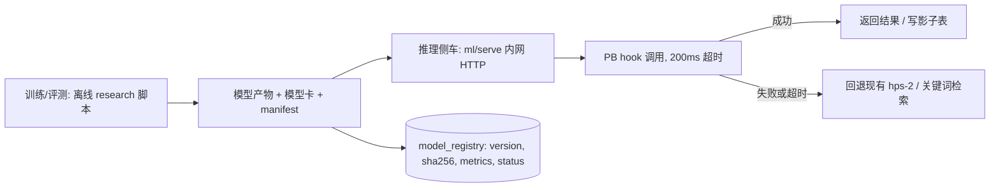

# 迁移学习在本系统的落地分析

> 状态：分析（2026-11）。结论先行：**能迁移的是「检索」「量表结构」「跨队列先验」「传感表征」，不能迁移的是 HPS 本身。**
> 本文只讨论方法与落地条件，不代表已实现；实现前置条件写在每一阶段里。

## 1. 结论

| 对象 | 是否值得迁移 | 为什么 | 最早可落地 |
|---|---|---|---|
| 知识库检索（预训练中文编码器） | **最值得，先做** | 不需要用户标签；评价指标现成（`qa_sessions.matched_entries` + `helpful`）；失败可无损回退 | 现在（2–3 周） |
| 量表结构（PHQ-9 / GAD-7 / ZBI 的因子与阈值） | 值得，但要克制 | 量表有公开发布的结构，可作为先验；但只能用于「锚定 HPS 分层」，不能反向宣称诊断 | n≥100 后（2–4 周） |
| 跨队列先验（合作机构 / 公开照护者队列） | 条件性值得 | 小样本下用层级模型借力比训网络可靠；需要数据协议与外部验证（组别与窗口见 [study-design.md](study-design.md)） | 有合作队列后 |
| 生理传感表征（HRV/GSR/睡眠） | 条件性值得 | 需要设备链路与足量长序列；当前 `physio_records` 以手动为主 | 设备数据 ≥150 人 × 14 天 |
| **HPS 权重/阈值本身** | **不要迁移** | 形成性指标（formative index），分量不是同一潜在特质的题项，没有可迁移的共同表征；权重是政策参数 | 永不 |

一句话：**本系统适合「迁移检索与测量学先验」，不适合「迁移一个压力分数模型」。**

## 2. 现状与约束（决定落地形态）

- 运行时是 PocketBase + goja JSVM：单二进制、无 ML runtime、无 numpy/torch。**任何模型推理都不能写在 hooks 里**。
- 数据规模：pilot 30–50 人、研究验证 100–150 人（见 [hps-method.md](hps-method.md)）；n 小、单中心、序列短。
- 已有可复用的地基：`stress_score_events`（append-only）、`algorithm_version` + `params` 快照、`coverage`、研究同意与去标识导出（[research-tools.md](research-tools.md)）、`manifest.json` 版本化。
- 缺的地基：`cohort` / `site` / `train_eligible` 字段、冻结的检索评测集、模型注册表、影子评分表。

因此落地形态只能是：

## 3. 四个可迁移对象的具体做法

### 3.1 检索迁移（优先级最高）

**现状**：`pb_hooks/lib/kb.js` 是关键词命中 + 2-gram 粗检索，取 top-3 拼接。没有语义召回，问法一变就漏。

**迁移方案**：

1. 选型：中文小模型（如 `bge-small-zh-v1.5`、`text2vec-base-chinese`），导出 ONNX，本地 CPU 推理；**不把用户问题发第三方**。
2. 知识库只有几十条，向量离线预计算即可：`kb_embeddings(entry_id, model_version, dim, vector)` 或直接随模型打包成 JSON 加载进内存。
3. 混合检索：关键词（现有）+ 向量，用 RRF 融合，保留完全确定性兜底。
4. 评测集：60–100 条真实提问 + 人工标注的目标条目，冻结版本；指标 **recall@3、MRR**；上线后加 `helpful` 率。

**验收与止损**：

- recall@3 相对基线提升 ≥ 0.10，且 bootstrap 95% CI 不含 0；
- P95 额外延迟 ≤ 30ms（近邻搜索在 100 条内可忽略）；
- 任一指标不达线 → 保留关键词链路，向量仅做"第二路"影子记录。

### 3.2 量表结构迁移（先验，不拟合）

**做法**：把 PHQ-9 / GAD-7 / ZBI-12 的公开发布结构（条目、计分、分级阈值、因子维度）作为**测量学先验**，用来：

- 校验 HPS 分层与「PHQ-9≥10 / GAD-7≥10 / ZBI 高负担」的锚定关系（收敛效度、AUC、校准）；
- 在层级模型里约束分量方向（例如生理分升高不应降低负担概率）。

**不做**：用这些量表反向训练一个"诊断模型"，或在 n<100 时拟合个体权重。

**落地形态**：离线跑（`research/` 脚本 + 统计环境），结果写 `stress_scores_shadow` 与模型卡；线上仍展示 hps-2。

### 3.3 跨队列先验（借力，不是搬模型）

小样本下最稳的"迁移"是**部分池化**：

- 层级贝叶斯模型：个体截距 + 队列效应，专家权重作为 informative prior；
- 若拿到合作队列：冻结特征 + 线性探针 → 重要性加权（协变量偏移）→ 仅在目标域不劣化时才考虑微调；
- 必做**负迁移检查**：目标域基线指标不得下降，子群（年龄、照护年限、城乡）不得系统性变差。

### 3.4 生理传感表征（等设备链路）

前置条件（当前都不满足）：

1. `device_registry` / `device_tokens` 与真实设备上报；
2. 每人 ≥14 天、采样频率一致；
3. n≥150（见 hps-method 的样本量估算）。

方法顺序：公开生理基础模型或自监督预训练 → **冻结表征 + 线性探针** → 才考虑端到端微调。目标是在缺失、噪声、设备差异下稳定，而不是提高"准确率"。

## 4. 需要补的数据与接口（一次做完，四个阶段共用）

| 项 | 内容 | 用途 |
|---|---|---|
| `users.cohort` / `users.site` | 队列与站点标识（默认 `pilot` / `local`） | 跨队列切分、留一队列验证 |
| `users.train_eligible` | 是否允许进入训练集（默认 false，随研究同意开启） | 与 `research_consents` 双保险 |
| 标签连接视图 | `stress_score_events` ↔ 同日 `assessments` | 锚定与校准 |
| 检索评测集 | `research/eval/retrieval.jsonl`（问题 + 金标条目 + 标注人） | recall@3 / MRR |
| `model_registry` | name/version/artifact sha256/dataset manifest/metrics/status(shadow|active|retired) | 可追溯、可回滚 |
| `stress_scores_shadow` | 候选模型输出（不影响展示） | 影子期对比 |
| 侧车接口 | `POST /embed {texts[]}`、`POST /predict {features}`，仅 127.0.0.1 | 推理入口 |

## 5. 分阶段路线与门禁

| 阶段 | 内容 | 前置 | 退出条件 |
|---|---|---|---|
| P0 地基（1–2 周） | cohort/site 字段、标签视图、检索评测集、模型注册表骨架 | 无 | 导出 manifest 含 cohort；评测集冻结并有基线分数 |
| P1 检索迁移（2–3 周） | ONNX 编码器 + 混合检索 + 影子对比 | P0 | recall@3 +0.10（CI 不含 0）；延迟达标；可一键回退 |
| P2 锚定与校准（2–4 周） | 量表先验 + 层级模型 + 影子评分 | n≥100、P0 | 校准斜率 0.8–1.2、Brier 不劣于基线；预注册主指标通过 |
| P3 跨队列（依赖合作） | 冻结特征 + 线性探针 + 域自适应 | 合作队列 + 数据协议 | 留一队列验证不劣化；子群公平性检查通过 |
| P4 传感表征（依赖设备） | 自监督/基础模型 + 探针 | 设备链路、n≥150、≥14 天/人 | 缺失与噪声下稳定；相对 hps-2 不劣化 |

**通用门禁**：影子期 ≥2 周或 ≥200 条样本；任何阶段不得降低现有链路表现；模型失败/超时一律回退。

## 6. 评估协议（先写死再跑）

- **预注册**：主指标（检索：recall@3；锚定：AUC 与校准）、次要指标、决策规则、停试条件。
- **切分**：按用户切分（同一用户的记录不得跨训练/测试），必要时按队列留一。
- **小样本**：嵌套交叉验证 + bootstrap CI；报告每个分量的覆盖率，缺失不零填充。
- **公平性**：按年龄/照护年限/城乡分组报告差异，不达标的模型不上线。
- **漂移**：特征 PSI、缺失率、分层分布；超阈值告警并回退。
- **模型卡**：训练数据 manifest、算法版本、指标与置信区间、已知限制、非适用场景。

## 7. 隐私与合规

- 编码与推理在本机（ONNX/CPU）；**不得**把用户问题或生理序列发给第三方编码/推理 API。
- 训练只用已同意且去标识的数据；`manifest.json` 必随模型归档。
- 模型输出沿用现有口径："分层提示 / 检索结果"，不出现"诊断、预测发作、替代医生"。
- 侧车只在 127.0.0.1 监听，不暴露公网；容器内存独立限额（建议 512m）。

## 8. 非目标（明确不做）

- n<100 时做端到端深度模型或个体化权重；
- 用 `simulated` / demo 数据训练任何东西；
- 用 LLM 在私有对话上微调；
- 把单中心结果外推为"通用模型"；
- 把 HPS 当成有共同潜在特质的反映性量表去做因子迁移。

## 9. 与现有文档的关系

- 测量学与样本量：[hps-method.md](hps-method.md)
- 数据导出、manifest、回放：[research-tools.md](research-tools.md)、[platform.md](platform.md)
- 问答链路与评测：[ai-agent.md](ai-agent.md)
- 运营与发布门禁：[console.md](console.md)
